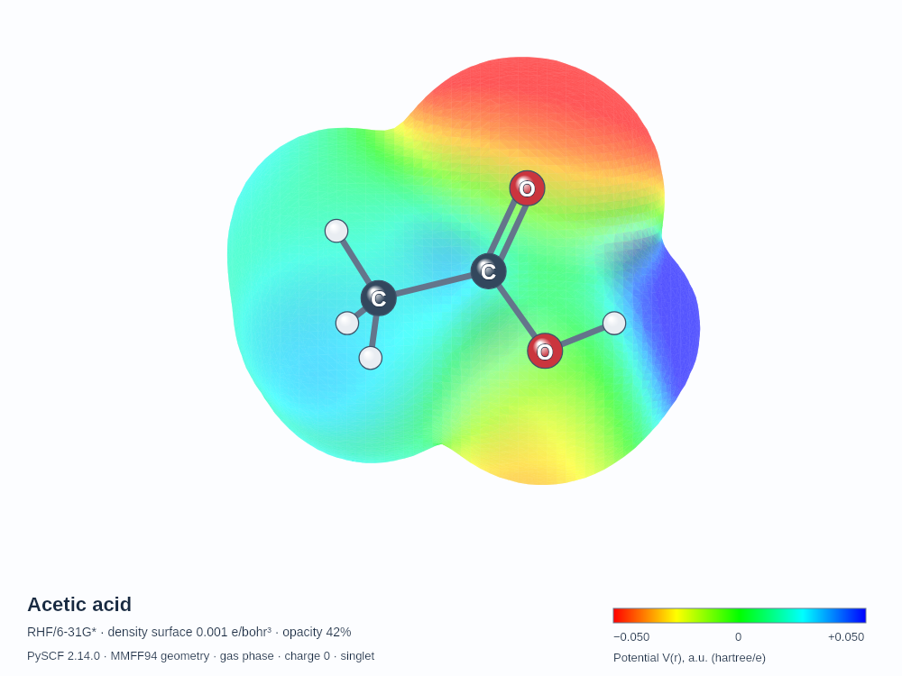
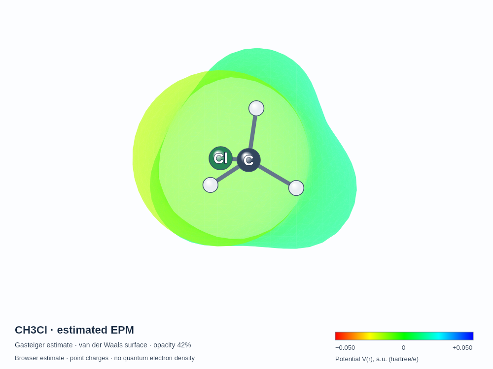
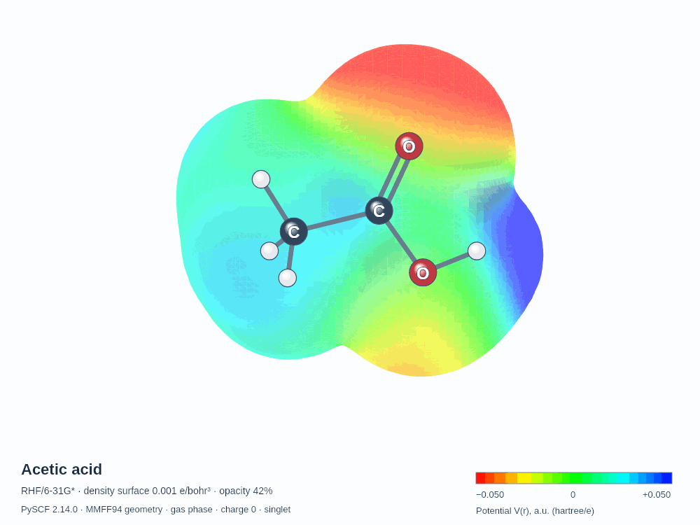

# EPM Studio · Beta

**[Use EPM Studio →](https://sowden94.github.io/EPM-Studio/)** · **[Methods and limitations](docs/browser-methods.html)** · **[Licence](LICENSE)**

**Draw a molecule. Explore its electrostatic potential. Make figures and rotating animations for teaching.**

EPM Studio combines an organic chemistry drawing editor with a molecular viewer. Draw a new structure and generate a qualitative potential estimate in your browser, explore six precomputed quantum-derived examples, or import matching density and potential cube files.

> **Beta — under active development.** New drawings use Gasteiger point-charge estimates on a van der Waals envelope. The bundled quantum examples use converged RHF/6-31G* calculations. These methods and surfaces differ; the maps are labelled with their method.

## See what you can make

| Quantum-derived example | New molecule, estimated locally |
|---|---|
|  |  |

These figures were rendered from EPM Studio data using its rendering and export functions. They illustrate the viewer; they are not screenshots of the latest interface. The acetic-acid map uses an RHF/6-31G* calculation on an RDKit-generated MMFF94 geometry, without quantum geometry optimisation. Chloromethane uses an empirical point-charge estimate. Their colours should not be treated as equivalent quantitative evidence. See [media notes](media/README.md) for provenance.

## Draw structures with familiar organic chemistry tools

The drawing panel sits beside the EPM viewer. Build bond-line structures with single, double, triple, wedge and dashed bonds, then choose **Show potential map**.

- Direct C, N, O and H buttons, plus F, Cl, Br, I, B, Si, P and S in **Other atoms**.
- Click a bond to cycle single → double → triple → single.
- Add or remove formal charges through the additional tools menu.
- Lasso a structure to move, rotate or delete the selected atoms together.
- Undo and redo edits, zoom the drawing, and use Fit and Tidy.
- Show implicit hydrogens as individual H atoms on explicit bonds, including in the flat EPM view.
- Download the drawn structure as a MOL file.

Browser estimates support up to **100 non-hydrogen atoms**, within **400 total atoms** including hydrogen. Valence, parameter and conformer-generation limits still apply. The editor is intended for supported organic structures; successful calculation is not guaranteed for every structure within those limits.

## Choose a flat map, a 3D model, or both

Switch between **Bond-line**, **Ball and stick**, and **Comparison mode** using the representation tabs.

- **Bond-line:** a flat EPM projection over the planar drawing. Carbon vertices remain implicit; darker bonds, clear H and heteroatom labels, lone pairs and formal charges remain visible through the colour overlay. This view stays flat when the 3D model rotates.
- **Ball and stick:** a freely rotating 3D model with depth shading, visible atoms and formal charges.
- **Comparison:** view the flat projection alongside the 3D map.

The flat drawing uses planar geometry for its estimated projection. Its values can differ from the 3D conformer's estimate; it is a schematic teaching view.

## Position the molecule for your lecture

Drag to rotate the 3D model. Use **Ctrl/Command-drag** for finer adjustment and **Alt-drag** to roll it. Directional controls, roll buttons, orientation presets and a sensitivity slider help place the model at the angle you want.

Zoom, pan, Fit, surface opacity and colour controls let you adjust the figure. The flat bond-line view supports pan and zoom while keeping the drawing planar.

On the default rainbow scale, **red is negative, green is zero and blue is positive**. Automatic scaling uses a symmetric range centred on zero so charged structures can retain visible variation. Fixed ranges are also available. Read the numerical legend when comparing maps: different automatic ranges do not imply equal potential magnitudes.

## Generate qualitative maps for new molecules

For new drawings, OpenChemLib generates a 3D conformer, MMFF94 refines it when supported, and Gasteiger–Marsili atomic charges provide a point-charge electrostatic-potential estimate on a smoothed van der Waals envelope.

**The molecular calculation stays in your browser.** Drawing and calculation do not require a separate server. Structure-image upload and image recognition have been removed.

Use browser estimates for qualitative polarity demonstrations. They do not compute quantum electron density and omit anisotropic charge density, halogen σ-holes, polarisation, solvent and conformational averaging. Changing the colour scale improves visibility without changing the underlying calculation.

## Explore quantum-derived examples and imported calculations

The six supplied examples are **formaldehyde, ethanol, acetone, benzene, acetic acid and methylamine**. They use converged PySCF RHF/6-31G* calculations with directly evaluated electrostatic potentials, on RDKit ETKDG/MMFF94 geometries without quantum geometry optimisation.

You can also import an electron-density cube and its matching electrostatic-potential cube from the same calculation. Grids and atom coordinates must match. Imported provenance and asserted units are not independently verified; retain the original calculation records.

See [Methods and limitations](docs/browser-methods.html) for sources and interpretation limits.

## Make lecture images and full-turn animations

Choose an orientation, adjust the surface and export a figure or a full-turn animation.

- **PNG:** 4K still images.
- **GIF:** 1280 × 720 looping animations.
- **WebM:** Full HD, QHD or 4K movies in browsers with supported WebCodecs encoding.
- **Calculation record:** metadata describing the method, geometry and display settings.

Exports include the potential scale and method. Animations rotate a static molecular model; they are not molecular dynamics simulations.

### Watch a full turn

A four-second example rendered with the application's software renderer and GIF encoding approach. This original example demonstrates a full rotation; current export resolution options are listed above.

## Access and privacy

The interface includes labelled inputs, visible keyboard focus, keyboard controls, molecular descriptions and numerical potential legends. **WCAG 2.2 AA is the target**; a complete manual and assistive-technology audit is still required.

Drawings, browser estimates and imported cube data remain in the browser. No recognition service or analytics is required. Save downloaded structures and original calculation files for your records.

## GitHub Pages

The static website lives in **`docs/`**. In **Settings → Pages**, choose **Deploy from a branch → main → /docs**, then Save. No npm build or separate calculation server is required to serve it.

When installing a small update, replace matching files and keep the existing **`docs/data/`** and **`docs/vendor/`** folders. The **`media/`** folder contains the images and animation displayed on this GitHub page.

**[Open the live website](https://sowden94.github.io/EPM-Studio/)**

## Licence and credits

First-party application code: **[GPL-3.0-only](LICENSE)**. Copyright © 2026 M. J. Sowden.

Third-party components retain their own licences. See [THIRD-PARTY-NOTICES.md](THIRD-PARTY-NOTICES.md) and the licence files under `docs/vendor/`. Scientific source citations are separate from software licensing.
