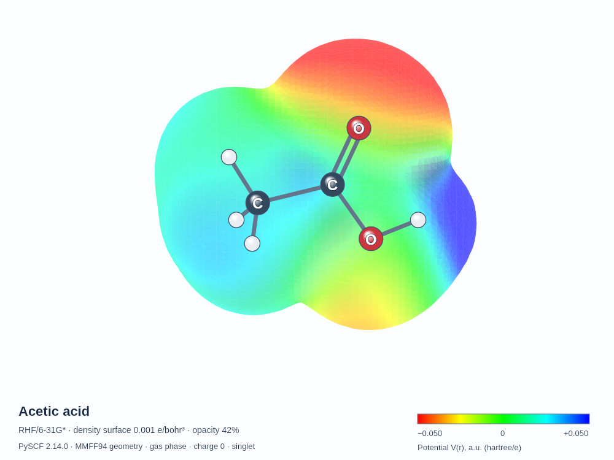
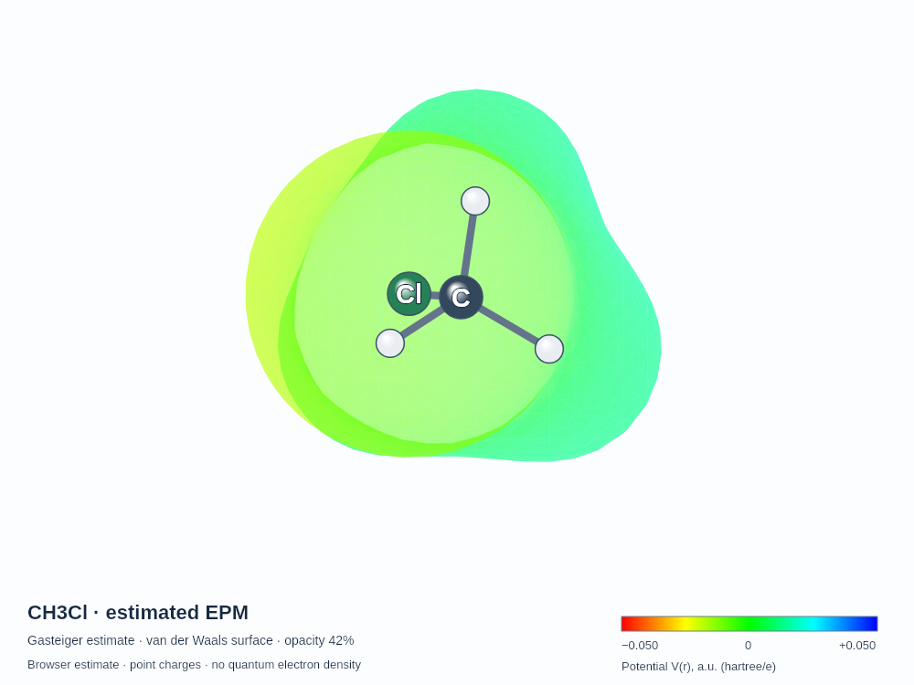
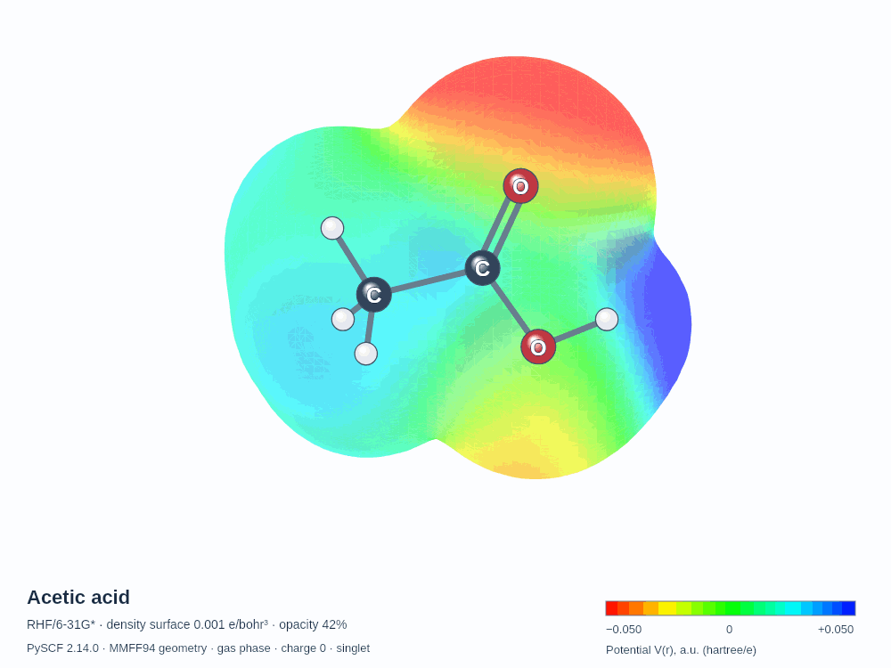

# EPM Studio · Beta

**Draw a molecule. Explore its electrostatic potential. Make clear figures and rotating animations for teaching.**

EPM Studio combines an organic chemistry drawing editor with a 3D molecular viewer. Generate a qualitative potential estimate for a new structure in your browser, explore six precomputed quantum-derived examples, or import matching density and potential cube files. Keep the atoms visible, adjust the rainbow surface and save a still image or full-turn animation for a lecture.

**[Open EPM Studio Beta →](https://sowden94.github.io/EPM-Studio/)** · **[Getting started](guides/user-guide.md)** · **[Methods and limitations](guides/methods.md)** · **[Licence](LICENSE)**

> **Beta — under active development.** Browser-generated maps are qualitative Gasteiger point-charge estimates on a van der Waals envelope. They are distinct from the quantum-derived maps supplied as examples. Review drawn structures and generated geometries before using them. The interface and supported chemistry may change as the project develops.
>
> **Beta:** hosted on GitHub Pages. Molecule input is drawing-only for now; image upload and automatic recognition are not available.

## See what you can make

| Quantum-derived example | New molecule, estimated locally |
|---|---|
|  |  |

These are actual application exports. The acetic-acid map comes from a converged RHF/6-31G* calculation on an RDKit-generated MMFF94 geometry, without quantum geometry optimisation. The chloromethane map is an empirical point-charge estimate on a smoothed van der Waals surface. Their methods and surface definitions differ; the colours should not be treated as equivalent quantitative evidence.

## Draw structures with familiar organic chemistry tools

The drawing panel stays beside the larger EPM viewer. Build bond-line structures with single, double, triple, wedge and dashed bonds. Select an atom and click a vertex to replace it, or place a new atom in empty space.

- C, N, O and H have direct toolbar buttons.
- **Other atoms** includes F, Cl, Br, I, B, Si, P and S.
- Add or remove formal charges, move atoms, erase bonds or atoms, and undo or redo edits.
- Use **Fit**, **Tidy** and keyboard drawing controls from the additional tools.
- Download the drawn structure as a MOL file.

The editor includes valence checks. It is not a general organometallic or coordination-chemistry editor; unusual valence states and unsupported structures may fail.

## Generate qualitative maps for new molecules

For an unmatched drawing, the browser generates a seeded 3D conformer using OpenChemLib, refines it with MMFF94 when supported, calculates Gasteiger–Marsili atomic charges, and evaluates their electrostatic potential over a smoothed van der Waals envelope.

**The molecular calculation stays on the visitor's device.** The website downloads the bundled chemistry libraries, but the drawing is not sent to a calculation server. The viewer, image captions and calculation record identify the result as an estimate.

Current limits include **40 non-hydrogen atoms**, **180 atoms after hydrogen addition** and a **60-second calculation timeout**. There is no fixed list of permitted compounds, but successful calculation is not guaranteed for every structure inside those limits. The charge parameters cover the toolbar elements subject to hybridisation and valence restrictions.

Use these maps for qualitative polarity demonstrations. They omit anisotropic electron density, halogen sigma-holes, polarisation, solvent and conformational averaging. They do not establish quantitative interaction energies, reaction selectivity or halogen-bonding behaviour.

## Explore quantum-derived examples and imported calculations

The six supplied examples are **formaldehyde, ethanol, acetone, benzene, acetic acid and methylamine**. They use converged PySCF RHF/6-31G* calculations with directly evaluated electrostatic potentials. Their density surfaces are available at **0.001, 0.002 and 0.005 e/bohr³**.

The default calculation mode uses a matching quantum example when available and a browser estimate for other drawings. Settings can force browser estimation for every drawing. A method badge identifies the current map.

You can also import an electron-density cube and its matching electrostatic-potential cube from the same calculation. Grids and atom coordinates must match. Imported provenance and asserted units are not independently verified, and bonds are inferred from the coordinates. Retain the calculation's original records.

**[Scientific methods, data sources and validation](guides/methods.md)**

## Keep the molecule visible

Adjust surface opacity while keeping atom spheres and bonds visible in front of the potential surface. Labels are centred on the spheres, without floating white boxes. Carbon and heteroatom labels appear by default; choose heteroatoms only, all atoms including H, or hide labels.

Choose the default **red → yellow → green → cyan → blue** rainbow scale or one of the alternative palettes. Negative potential is red and positive potential is blue on the default scale. The visible numerical legend accompanies image and animation exports.

## Make lecture images and full-turn animations

Drag the molecule, use keyboard rotation controls, zoom and start or pause automatic rotation. Choose the orientation you want before exporting.

- **PNG:** a 1000 × 750 still image with a method caption and potential scale.
- **GIF:** a complete 360° turn, set to loop, with 4-, 8- or 12-second duration options.
- **WebM:** a full-turn movie where the browser supports MediaRecorder and the selected video format. Enable repeat in your presentation or player when needed.
- **Calculation record:** JSON metadata describing the method, geometry, display settings and relevant source information.

Animations rotate a static molecular model; they are not molecular dynamics simulations. Estimated-map exports retain the estimate label and van der Waals surface description.

### Watch a full turn

A four-second full turn rendered with the application’s software renderer and GIF export pipeline. See [media notes](media/README.md) for provenance.

## Access and privacy

The interface includes labelled inputs, visible keyboard focus, keyboard drawing and viewer controls, readable molecular descriptions, numerical potential legends and a paused initial view. **WCAG 2.2 AA is a target, not a certified conformance claim**; full assistive-technology and manual accessibility testing remains necessary.

Drawings, local EPM estimates and imported cube data remain in the browser. Image upload and automatic image recognition are not included in this beta. There are no user accounts or cloud project backups in this portable edition. Keep downloaded structures and your original calculation files.

## Learn, report and contribute

- **[User guide](guides/user-guide.md):** drawing, maps, labels and lecture exports.
- **[Methods](guides/methods.md):** distinctions between map types and interpretation limits.
- **[Contributing](CONTRIBUTING.md):** development setup and changes.
- **[Security](SECURITY.md):** reporting a suspected vulnerability.
- **[Changelog](CHANGELOG.md):** notable changes.
- **[Third-party notices](THIRD-PARTY-NOTICES.md):** dependencies, methods and bundled licence texts.

GitHub's Code, Issues, Pull requests, Actions, Releases and Security areas are controlled by the repository settings. The included issue templates become available when uploaded under `.github/ISSUE_TEMPLATE`. No desktop release or automated GitHub deployment workflow is included in this package.

## Licence

EPM Studio's original application code is licensed under the **[GNU General Public License, version 3](LICENSE)** (**GPL-3.0-only**), matching Crystal Studio. You may use, study, modify and redistribute it under those terms. The software is provided without warranty.

Copyright © 2026 M. J. Sowden.

Bundled third-party components retain their own licences and copyright notices; see **[THIRD-PARTY-NOTICES.md](THIRD-PARTY-NOTICES.md)** and the licence texts under `docs/vendor/`. Scientific source citations are separate from software licensing.
